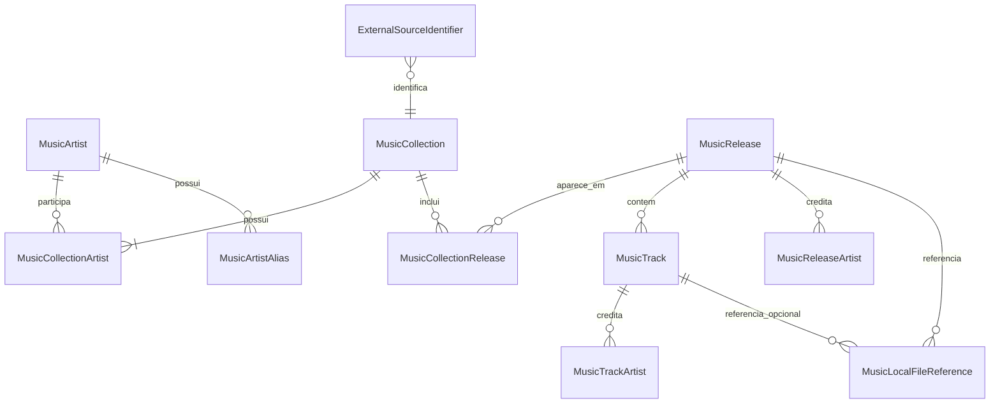

# ApiMusicX

A **ApiMusicX** é a API ASP.NET Core (.NET 10) que persiste e consulta a **Coleção local de discografias** (artistas, coleções, releases, faixas, créditos, identificadores externos e referências de arquivos) em SQL Server relacional. Ela funciona **sem internet, sem a [ApiDiscogs](26_ApiDiscogs.md) e sem acesso ao disco**: apenas armazena dados já normalizados e referências relativas a arquivos que existem fora da API. Este documento cobre só o lado API; o fluxo de importação e a UI estão em [11_WinAppDtudo.md](11_WinAppDtudo.md).

Contexto: [00_Solucao.md](00_Solucao.md) · Segurança: [01_Solucao_Seguranca.md](01_Solucao_Seguranca.md) · Gateway: [20_DtudoGateway.md](20_DtudoGateway.md) · Identidade: [21_ApiIdentity.md](21_ApiIdentity.md) · Site: [10_DtudoSite.md](10_DtudoSite.md) · Biblioteca: [30_LibDtudo.Shared.md](30_LibDtudo.Shared.md).

## Visão geral

| Item | Valor |
|---|---|
| Projeto / testes | `ApiMusicX` / `tests\ApiMusicX.Tests` |
| Stack | .NET 10, EF Core 10 (SQL Server), JWT Bearer, Serilog (Console + Seq opcional), Swashbuckle |
| Prefixo das rotas | `apiLocal` |
| URLs de desenvolvimento | `https://localhost:63982` / `http://localhost:63983` |
| Audience | `urn:dtudo:api-musicx` (Issuer: ApiIdentity) |
| Consumidores | `WinAppDtudo` (leitura e importação confirmada), `DtudoSite` via gateway (leitura) |
| Dependências | `LibDtudo.Shared` (logging/correlação) — **não** referencia Discogs nem sistema de arquivos |

## Decisões de domínio vigentes

1. **`MusicCollection` é a unidade local que representa uma Coleção de discografia.** O termo "Catálogo" não é usado como nome de entidade, regra, rota ou contrato novos neste domínio (as permissões `catalog.*` são uma convenção herdada de autorização compartilhada).
2. Artistas, coleções, releases e faixas são **entidades separadas** (não há documento JSON único); chaves primárias locais `long` geradas pelo banco. IDs de fontes externas são identificadores opcionais, **nunca** chave primária.
3. Uma coleção pode ter vários artistas; um release pode estar em várias coleções (compilações, colisões de `discogs_id` do legado).
4. A Discogs é só **um provedor possível** de identificadores e dados; nenhum valor Discogs é obrigatório para criar registros.
5. Referências locais guardam apenas **caminho relativo normalizado**; a API nunca cria, move, verifica ou apaga arquivos (validação puramente textual: rejeita caminho absoluto, unidade, UNC, `..` e vazio).
6. Reimportações são **mesclagens não destrutivas**: preenchem campos vazios, não sobrescrevem valores existentes e divergências viram 409.
7. Tipos e DTOs ficam no próprio projeto; só sobem para a LibDtudo.Shared quando houver consumidores reais em mais de um projeto. Entidades/DTOs de anime não são reaproveitados.
8. `WinAppDtudo` orquestra (busca na ApiDiscogs → confirmação → importação aqui); a ApiDiscogs nunca chama a ApiMusicX.

## Modelo de dados



| Entidade | Pontos essenciais |
|---|---|
| `MusicArtist` | `DisplayName`, `NormalizedName` (índice não único; homônimos existem), `ArtistType` (`Unknown/Solo/Band/Group`), `SortName`; aliases em `MusicArtistAlias` (único por artista + valor normalizado) |
| `MusicCollection` | `DisplayName` (≤ 256), `NormalizedName` (índice), `Description` (≤ 2000) |
| `MusicCollectionArtist` | PK composta; `Role` (`Unknown/Primary/Member/Associated`) |
| `MusicRelease` | `Title` (≤ 512), `NormalizedTitle`, `ReleaseType` (`Unknown/Album/Single/EP/Compilation/Video`), `ReleaseYear` (1000–9999 por check), `Notes` |
| `MusicCollectionRelease` | PK composta; `SourceCategory` (≤ 64), `DisplayOrder` |
| `MusicReleaseArtist` / `MusicTrackArtist` | créditos; `Role` (`Unknown/Primary/Featured/Composer`) |
| `MusicTrack` | `PositionLabel`, `Sequence`, `Title`, `NormalizedTitle`, `DurationSeconds`/`DurationText`, `Notes`; únicos por release + posição/sequência + título normalizado |
| `MusicLocalFileReference` | `RelativePath`/`NormalizedPath` (≤ 1024), `MediaKind` (`Other/Audio/Image/Document`), `Role` (`Unknown/TrackAudio/Cover/Booklet/Artwork`); release sempre preenchido, faixa opcional; único por proprietário + caminho normalizado |
| `ExternalSourceIdentifier` | `Provider`, `ResourceType`, `ExternalId`; **exatamente um proprietário** (artista, coleção, release ou faixa, por check); único por `Provider + ResourceType + ExternalId` |

Enums são persistidos como texto. Exclusão: apagar uma coleção remove seus vínculos e identificadores, mas **não** apaga releases compartilhados; faixas, créditos e referências seguem em cascata do release.

## Endpoints

Todas as rotas exigem JWT (política de fallback: autenticado) e permissão + escopo equivalentes.

| Método e rota | Permissão | Resultado |
|---|---|---|
| `GET apiLocal/Health` | `health.read` | 200 `HealthResponse` ou 503 (banco indisponível) |
| `GET apiLocal/collections?page=&pageSize=&search=` | `catalog.read` | `PagedResponse<MusicCollectionSummaryDto>` (`pageSize` 1–100; busca por nome normalizado da coleção, do artista e aliases) |
| `GET apiLocal/collections/{id:long}` | `catalog.read` | `MusicCollectionDto` completo; 404 |
| `GET apiLocal/collections/{id:long}/releases?page=&pageSize=` | `catalog.read` | `PagedResponse<MusicReleaseDto>` com faixas |
| `POST apiLocal/collections` | `catalog.write` | 201 `MusicCollectionDto` (artistas já existentes) |
| `PUT apiLocal/collections/{id:long}` | `catalog.write` | 204 (nome/descrição) |
| `POST apiLocal/collections/import` | `catalog.write` | 201 (criou) ou 200 `ImportMusicCollectionResponse` |
| `DELETE apiLocal/collections/{id:long}` | `catalog.delete` | 204 |
| `GET apiLocal/artists?search=&page=&pageSize=` | `catalog.read` | artistas paginados |
| `GET apiLocal/artists/{id:long}` | `catalog.read` | `MusicArtistDto` (aliases, coleções, identificadores) |
| `GET apiLocal/releases/{id:long}` | `catalog.read` | `MusicReleaseDto` |

Rotas expostas pelo gateway (cluster `api-musicx-catalog`, repassando o `Authorization`): `/api/catalog/music/collections`, `…/collections/{id}`, `…/collections/{id}/releases`, `…/artists`, `…/artists/{id}`, `…/releases/{id}`. **Escrita/importação não passam pelo gateway** (o WinApp as chama direto). Ver [20_DtudoGateway.md](20_DtudoGateway.md).

### Erros

`MusicExceptionHandler` converte falhas conhecidas em `ProblemDetails` (`application/problem+json`) com extensão `code`, sem expor detalhes internos:

| Exceção | HTTP | `code` |
|---|---|---|
| `MusicValidationException` / `ArgumentException` | 400 | `music.validation` |
| `MusicNotFoundException` | 404 | `music.not_found` |
| `MusicConflictException` | 409 | `music.conflict` |
| `DbUpdateException` | 409 | `music.persistence_conflict` |
| demais | 500 | `music.internal` |

## Contrato conceitual de importação

`POST apiLocal/collections/import` aceita **somente dados já normalizados** (o WinApp converte o resultado da Discogs). Resumo do contrato (`ImportMusicCollectionRequest`):

- Identidade obrigatória: `MusicCollectionId` **ou** um `ExternalIdentifier` de `ResourceType = Collection`; sem isso → 400. Pelo menos 1 artista (máx. 100).
- Conteúdo: `DisplayName`, `Description`, `ExternalIdentifiers` (≤ 20), `Artists` (com `Role` na coleção, aliases e identificadores), `Releases` (≤ 1000) com `ReleaseType`, `ReleaseYear`, `SourceCategory`, `DisplayOrder`, `ArtistCredits`, `Tracks` (≤ 1000) e `LocalFileReferences` (≤ 1000, caminho relativo).
- Resposta: coleção resultante + `Created`, `Changed` e contadores (`ArtistsAdded`, `ReleasesAdded`, `TracksAdded`, `LocalFileReferencesAdded`).

Regras de idempotência e mesclagem (confirmadas no serviço):

1. **Transacional:** toda a importação (coleção, vínculos, releases, faixas, referências) numa única transação; violações de índice único viram reconsulta idempotente ou 409.
identificadores apontando para coleções diferentes → 409. Nome ou descrição divergentes do valor local → 409 (descrição só é preenchida se vazia).
por ID/identificador externo; sem eles, por nome normalizado ou alias — um único candidato é reutilizado e mais de um → 409 (informar identificador). Papel na coleção divergente → 409.
4. **Release:** por ID/identificador externo; sem eles, dentro da coleção por título normalizado + tipo (compatível) + ano. Mais de um candidato, ou candidato único sem ano para confirmar → 409. Um release (mesmo `Provider/ResourceType/ExternalId`) pode ser compartilhado por várias coleções.
identificador externo; senão título normalizado dentro do release (+ posição/sequência quando informadas); mais de um candidato, ou candidato único sem posição/sequência para confirmar → 409.
6. **Referência local:** normaliza o caminho, evita duplicidade por proprietário; associar o mesmo caminho a outro release → 409. Nunca consulta o disco.
7. **Campos:** preenche apenas vazios; divergência com valor local → 409 (nunca sobrescreve).
8. `master` e `release` da Discogs são `ResourceType` distintos em `ExternalSourceIdentifier` e podem apontar para o mesmo release local.

Migração do JSON legado (já concluída conceitualmente): o ID legado da coleção é preservado como identificador externo (`Provider` legado, `ResourceType = Collection`), `singles-EP` permanece `ReleaseType = Unknown` até haver regra confiável, e nomes de arquivos de áudio **não** geram faixas.

## Segurança

- JWT Bearer com `Authentication:Issuer` (HTTPS absoluto) e `Authentication:Audience` validados no startup; `MapInboundClaims=false`; tolerância de 1 min.
- Policies `permission:{x}` exigem claim `permission` **e** o mesmo valor em `scope`/`scp`: `catalog.read`, `catalog.write` (inclui `import`), `catalog.delete`, `health.read`.
- A audience `urn:dtudo:api-musicx` está provisionada no [ApiIdentity](21_ApiIdentity.md) (seeder do OpenIddict).
- CORS por `Cors:AllowedOrigins` (HTTP(S) únicos; em produção só HTTPS e nunca curinga). Swagger só em Development e restrito a `health.read`.
- Logs com `SensitiveDataRedactionEnricher`, correlação `X-Correlation-ID` (`RequestCorrelationMiddleware`) e Serilog request logging.
- Sem chamadas externas: não há risco de SSRF nem segredos de terceiros nesta API.

## Configuração e migrações

| Chave | Descrição |
|---|---|
| `ConnectionStrings:LocalDbConnection` | **Segredo** (User Secrets, id `dtudo2026-apimusicx`); validada no startup. Usar placeholder em documentação |
| `Authentication:Issuer` / `Audience` | Em Development: Issuer `https://localhost:7243/`, Audience `urn:dtudo:api-musicx` (não consta no `appsettings.json` base) |
| `Cors:AllowedOrigins` | Em Development: `http://localhost:5173`, `http://localhost:5178` |
| `Seq:Url` | Opcional (`http://localhost:5341`) |

- Migração única: `20260811054418_InitialMusicCollection`. **Não há `Database.Migrate()` no startup**; aplicar manualmente (`dotnet ef database update`).
- `MusicContextFactory` (design-time) usa a connection string de configuração e, se ausente, um fallback LocalDB apenas para desenvolvimento.

## Testes

`tests\ApiMusicX.Tests` (xUnit):

- `ApiMusicXIntegrationTests` (4): autenticação/permissão, contratos de coleção e health, reimportação idempotente sem sobrescrever nome, CRUD por política;
- `MusicContextPersistenceTests` (8): schema relacional, relacionamentos, unicidade e proprietário único de identificadores, reimportação sem duplicar, rejeição de caminho absoluto/traversal, migração presente;
- `MusicMapperTests` (2).

```powershell
dotnet test .\tests\ApiMusicX.Tests\ApiMusicX.Tests.csproj
```

## Pendências/Divergências

- **Referências ao `ApiNode`:** `ApiMusicX\README.md` e o comentário XML de `MusicCollectionImportService` ainda citam o ApiNode, removido do repositório; o texto deve ser atualizado (o código não depende dele).
- **Provedor legado nos documentos:** o texto de decisão cita `Provider = ApiNode.MyMusicX` para o ID legado; o código aceita `Provider` livre (≤ 64) — convém fixar um nome neutro (ex.: `LegacyMyMusicX`) na importação.
a chave de ocorrência para releases sem `discogs_id` não está implementada; o serviço trata como identificador genérico
- **Edição parcial:** `PUT` altera só nome/descrição; vínculos, releases e faixas mudam apenas por importação (não há CRUD de artistas/releases).
- **Escrita fora do gateway:** o gateway publica só leitura; confirmar se isso é intencional para o site.
- **Decisões em aberto herdadas do documento de domínio:** política de `Idempotency-Key` para entradas sem identificador, limites finais de caminho relativo e eventual promoção de DTOs para a LibDtudo.Shared.
